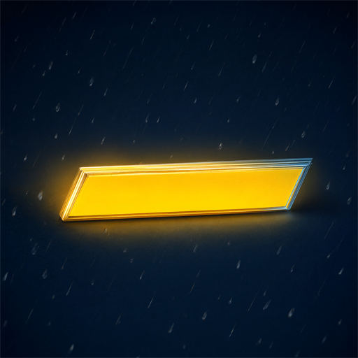
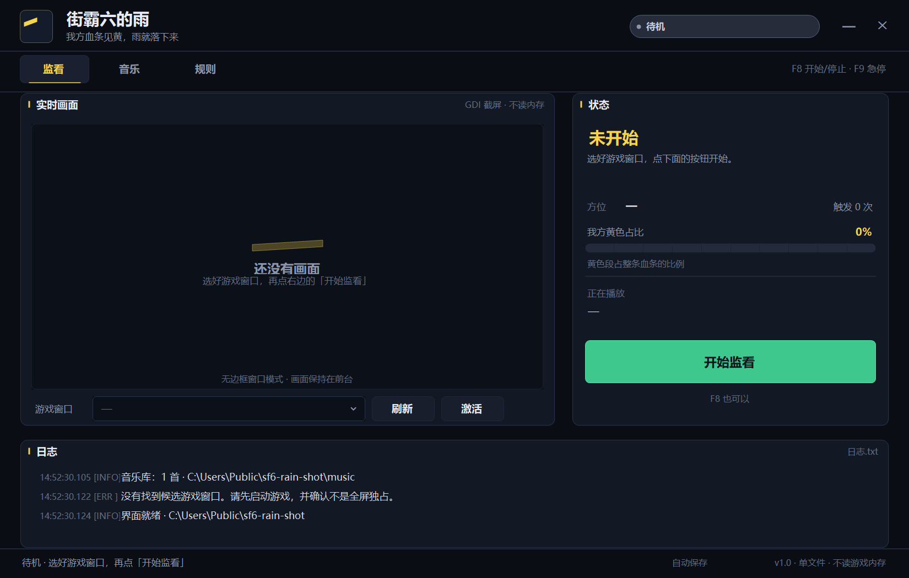
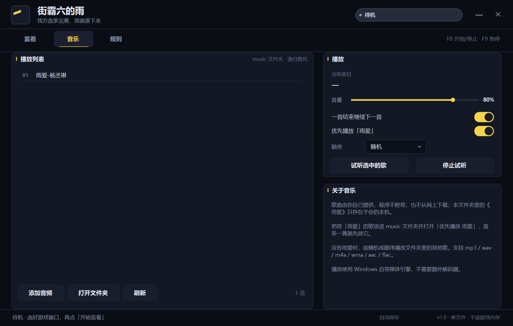
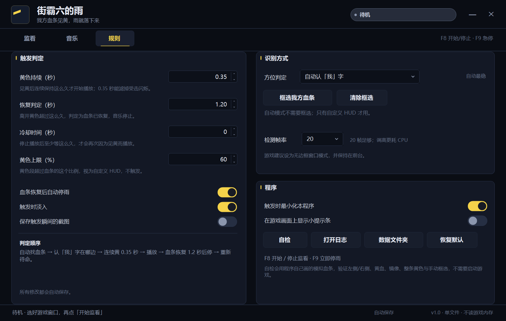

<div align="center">



# 街霸六的雨 · SF6 Rain

**《街霸 6》里我方血条变黄的瞬间，雨就落下来。**

Windows 10/11 · .NET Framework 4.8 · 单文件 · 不读内存 · 不联网

</div>

---

## 这是什么

一个给《Street Fighter 6》用的桌面小工具：**只盯着你自己的血条**。当你的血量低到变黄、并稳定持续 0.35 秒，它会自动播放你放在 `music` 文件夹里的歌（默认优先《雨爱》）；血条恢复 1.2 秒后淡出停止。对手被打到黄血不会触发。

识别左右不靠位置猜：血条上方那个白色的 **「我」** 字在左就在左，在右就在右。两种情况都已经在实机验证过，也支持手动框选兜底。

> 本仓库**不附带任何歌曲录音**。「雨爱」的版权属于原权利人，请使用你自己合法获得的音频。



<p align="center">
  
  
</p>

## 特性

- **只认我方**：靠白色「我」字判定左右，对手见黄不触发；左右两侧都能用。
- **不碰游戏进程**：GDI 截取窗口画面，不读内存、不注入、不 Hook、不联网。
- **防误触**：黄色需持续 0.35 秒；黄色占了大半条（>60%，常见于自定义 HUD）直接忽略；可设冷却。
- **手动框选**：改模 HUD 或「我」字被特效挡住时，拖一个框圈住自己的血条即可。
- **实机可用**：无边框窗口、高 DPI（150%/200%）、最小化后 F8/F9 热键仍然有效。
- **单文件**：`sf6-rain.exe` 一个文件，不装 Python/Node，不需要管理员权限。
- **可审计**：全部 C# 5 源码在 `src/`，用 Windows 自带的编译器就能重建。

## 快速开始

1. 运行 `sf6-rain.exe`（本仓库或 Releases 里都有）。
2. 把你自己合法持有的音频放进 `music\`（mp3 / wav / wma / m4a / aac / flac，可放多首）。
   文件名带「雨爱」或「rain love」的歌会被优先选中。
3. 打开街霸 6，画面设置用 **无边框窗口**，不要用全屏独占。
4. 在「游戏窗口」里选中 **Street Fighter 6**，点绿色的 **开始监看**。
5. 挨打，见黄，雨落。按 **F9** 可以立刻急停。

## 识别原理

```
GDI 截屏 ──► 定位血条带 ──► 找「我」字定方位 ──► 量黄色段 ──► 状态机 ──► 播放/淡出
             (y 3.5%~24%)   (两侧外端白点)       (内缘锚定)    0.35s / 1.2s
```

- 血条从外向内掉血，彩色填充总在内缘结束，所以内缘是对称、稳定的锚点。
- 只看你那条血条的黄色占比；每一行取最长黄色段的中位数，避开高光。
- 方位有 1.5 秒记忆和投票锁，避免一帧误判导致左右横跳。
- 画面全黑时自动改用 `PrintWindow(PW_RENDERFULLCONTENT)` 再抓一次。

更细的阈值、状态机与缓存策略见 [docs/how-it-works.md](docs/how-it-works.md)。

## 构建

要求：Windows 10/11（自带 .NET Framework 4.8）。不需要 Visual Studio，也不需要 .NET SDK。

```bat
build.cmd
```

脚本会把源码复制到 `%TEMP%`，再用系统自带的 `csc.exe` 编译，最后把 `sf6-rain.exe` 放回仓库根目录。**这样做是因为 csc 读不了中文路径下的源码**，脚本会自动绕开。

<details>
<summary>手动编译（等价命令）</summary>

```bat
csc /target:winexe /platform:x64 /optimize+ /unsafe /codepage:65001 ^
    /win32icon:assets\app.ico /win32manifest:app.manifest ^
    /resource:assets\app.png,Sf6Rain.logo.png ^
    /out:sf6-rain.exe src\*.cs ^
    /r:System.dll /r:System.Core.dll /r:System.Drawing.dll /r:System.Windows.Forms.dll ^
    /r:"%WINDIR%\Microsoft.NET\Framework64\v4.0.30319\WPF\PresentationCore.dll" ^
    /r:"%WINDIR%\Microsoft.NET\Framework64\v4.0.30319\WPF\WindowsBase.dll"
```

源码路径必须是纯英文。音频播放用 WPF 的 `MediaPlayer`，所以需要额外引用两个 WPF 程序集。

</details>

## 配置

首次正常退出后在程序目录生成 `config.json`，也可以在界面里改。「规则」页覆盖了常用项。

| 键 | 默认 | 说明 |
|---|---|---|
| `window_title` | `Street Fighter 6` | 上次选择的窗口 |
| `side_mode` | `auto` | `auto` / `left` / `right` / `manual` |
| `manual_bar` | `null` | 手动框选，归一化 `[x, y, w, h]` |
| `yellow_hold_seconds` | `0.35` | 黄色持续多久才触发 |
| `clear_seconds` | `1.2` | 血条恢复多久后停声 |
| `stop_on_clear` | `true` | 关掉则一直放到歌曲结束 |
| `yellow_max_fraction` | `0.6` | 超过就当作自定义 HUD 忽略 |
| `cooldown_seconds` | `0` | 两次触发的最小间隔 |
| `target_fps` | `20` | 截屏频率 |
| `loop` | `true` | 一首结束且仍黄血时接着放 |
| `prefer_rain_love` | `true` | 优先选文件名带「雨爱」的歌 |
| `play_order` | `shuffle` | `shuffle` / `ordered` |
| `volume` | `0.8` | 0 ~ 1 |
| `show_overlay` | `false` | 游戏上方的小提示卡 |
| `save_trigger_shots` | `false` | 触发时保存截图到 `captures\` |
| `fade_in` | `true` | 淡入 |

`layouts` 是程序自动学到的各宽高比血条位置，一般不用手动改。

## 目录结构

```
sf6-rain.exe          编译好的单文件程序
build.cmd             一键构建（复制到 %TEMP% 编译）
app.manifest          高 DPI 声明
assets/               图标与嵌入的界面 Logo
docs/                 原理说明与界面截图
music/                放你自己的音频（仓库里为空）
src/                  全部 C# 源码
```

## 常见问题

<details>
<summary>点了开始却没有画面</summary>

游戏必须是**无边框窗口**，且不要被别的窗口完全遮住。全屏独占模式抓不到。
</details>

<details>
<summary>一直提示「没认出我字」</summary>

规则页把方位改成手动框选，回监看页圈住自己的血条；或者临时强制左 / 右。
</details>

<details>
<summary>没有声音 / 提示播放失败</summary>

确认 `music` 里有音频，点「音乐」页的「试听选中歌曲」，再检查系统音量和默认输出设备。WPF 媒体引擎支持常见的 mp3/wav/m4a。
</details>

<details>
<summary>杀毒软件报未知程序</summary>

这是未签名的自编译 exe，没有数字证书。源码完全公开，可自行用 `build.cmd` 重建，或把目录加入信任。
</details>

## 隐私与版权

- 只用 GDI 截取窗口像素；不读游戏内存、不注入、不写游戏目录、不发起任何网络请求。
- 与 Capcom 无关。Street Fighter 6 及其素材、商标归 Capcom 所有；本项目仅出于个人娱乐目的制作。
- 参考了 [nightreign-rain](https://github.com/yyysjQvQ/nightreign-rain) 的产品思路（「黄血下雨」），代码为独立实现。

## License

[MIT](LICENSE)

---

## English

**SF6 Rain** is a tiny Windows tray-less companion for *Street Fighter 6*: it watches **your own** health bar through plain GDI screen capture and, when your bar turns yellow for 0.35 s, plays an audio file you provide. The white 「我」 ("me") tag on the HUD decides whether your bar is the left or the right one, so it works from either side; the opponent's low health never triggers it. Playback fades out 1.2 s after your bar recovers, and F9 cuts the sound immediately.

- No memory reading, no injection, no hooks, no network. Just pixels.
- No music is bundled — bring your own legal copy of any song.
- Not affiliated with Capcom. Street Fighter 6 is a trademark of Capcom.
- Build with `build.cmd` on Windows 10/11 (uses the built-in .NET Framework 4.8 compiler), or grab the prebuilt `sf6-rain.exe`.
- Licensed under MIT.

See [docs/how-it-works.md](docs/how-it-works.md) for the detection pipeline (in Chinese).
